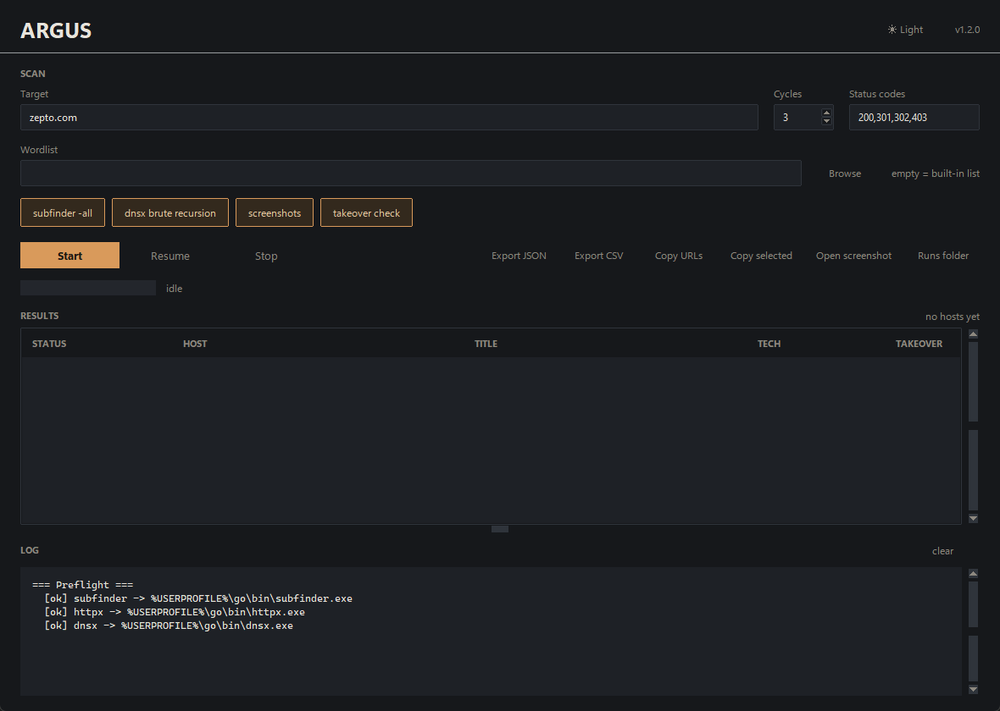
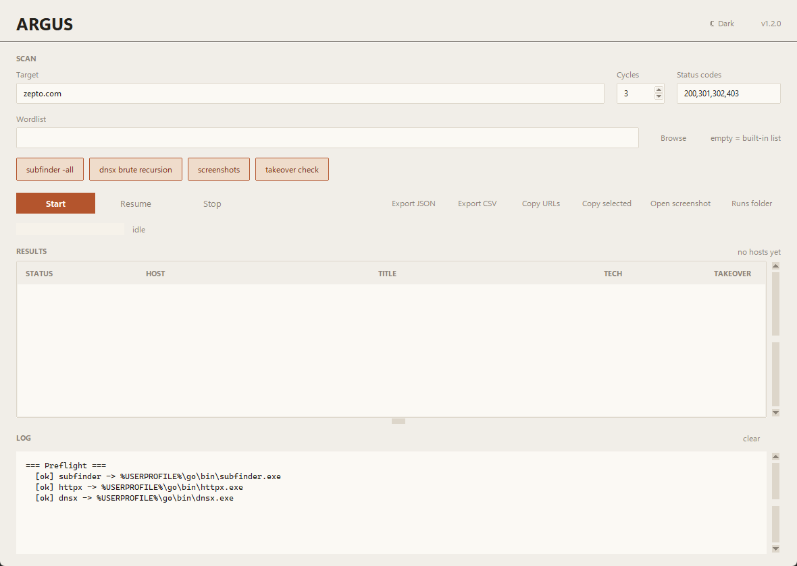
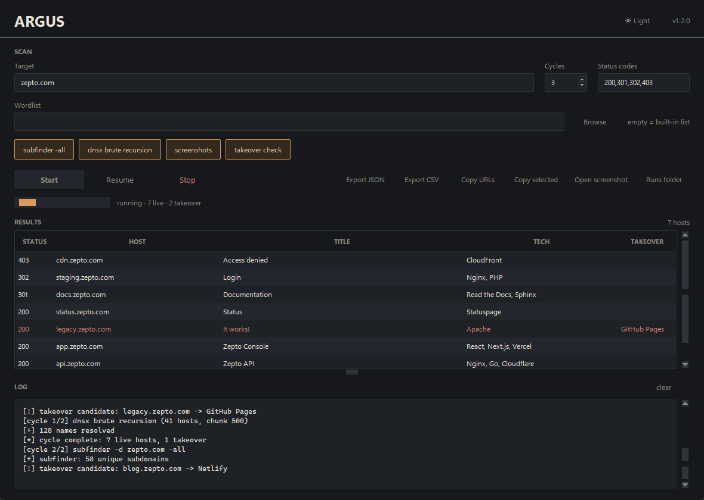
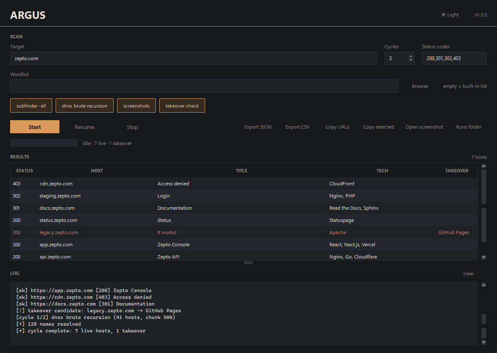
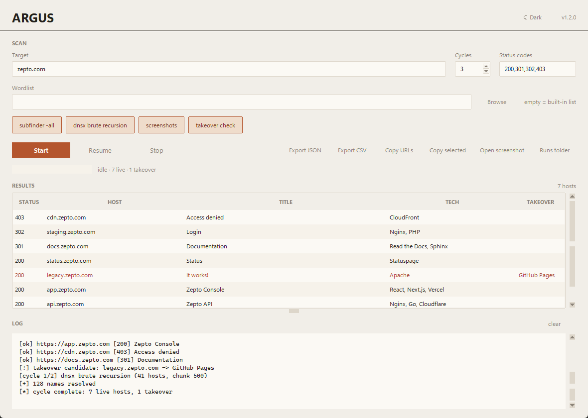

# Argus

Argus is a Windows/Linux desktop GUI for recursive subdomain reconnaissance. It chains
[`subfinder`](https://github.com/projectdiscovery/subfinder),
[`httpx`](https://github.com/projectdiscovery/httpx) and
[`dnsx`](https://github.com/projectdiscovery/dnsx) into a repeatable pipeline
and adds a results table, session resume, run history and subdomain-takeover
checks.

Repository: [github.com/r4tnadeepbose/Argus](https://github.com/r4tnadeepbose/Argus)

> The application is named **Argus**; the internal Python package is still
> `recon`, which is why `python -m recon` and the `recon/` folder appear below.

> **Authorized use only.** Run this tool only against domains you own or are
> explicitly authorized to test (for example a published bug-bounty scope).
> DNS brute forcing and HTTP probing against third-party systems may violate
> laws, terms of service and hosting policies. You are responsible for the
> targets you enter.

---

## Features

<p align="center">
  
  <br>
  <sub>Argus main window — Slate dark theme, scan form, result table and streaming log.</sub>
</p>

| Feature | Description |
|---|---|
| Recursive enumeration | Passive discovery with `subfinder`, active prefix brute force with `dnsx`, repeated up to *N* cycles |
| HTTP probing | `httpx` keeps only hosts matching your status-code filter |
| Metadata | Title, technology stack, CNAME chain and optional screenshots per host |
| Takeover checks | Flags dangling CNAMEs pointing at unclaimed SaaS services (GitHub Pages, S3, Heroku, Azure, Netlify, …) |
| Resume | Stop at any time and continue from the exact dnsx chunk |
| Run history | Every run keeps `state.json`, `results.json` and screenshots under `runs/<run_id>/` |
| Export | JSON, CSV, copy-all/selected URLs, open screenshots |
| Theme | Minimal retro-modern UI with **Slate** (dark) and **Paper** (warm light) palettes, switchable from the ☀/☾ header button |
| UI | Live results table, progress bar, streaming log |

## Requirements

- Python **3.10+** with Tkinter
- [`subfinder`](https://github.com/projectdiscovery/subfinder), [`httpx`](https://github.com/projectdiscovery/httpx) and [`dnsx`](https://github.com/projectdiscovery/dnsx) (ProjectDiscovery)
- Headless Chrome/Chromium only if you enable screenshots (`httpx -ss`)

The application itself has **no third-party Python dependencies** (standard
library only). See [docs/installation.md](docs/installation.md) for setup.

## Quick start

```powershell
# 1. install the recon tools (Go required)
go install github.com/projectdiscovery/subfinder/v2/cmd/subfinder@latest
go install github.com/projectdiscovery/httpx/cmd/httpx@latest
go install github.com/projectdiscovery/dnsx/cmd/dnsx@latest

# 2. point the app at them (or let it fall back to PATH)
#    edit TOOL_PATHS in recon/constants.py

# 3. run the GUI
python argus.py
#    or: python recon_gui.py  |  python -m recon
```

On Windows, the default `TOOL_PATHS` in
[`recon/constants.py`](recon/constants.py) point at `%USERPROFILE%\go\bin`.

<p align="center">
  
  <br>
  <sub>Same window in the Paper light theme — the ☀ Light / ☾ Dark button switches palettes at runtime.</sub>
</p>

## Usage

1. Enter a target such as `example.com`.
2. Set **Cycles** (recursion depth) and the **Status** codes to keep.
3. Optionally choose a wordlist file; otherwise the built-in list is used.
4. Toggle **Screenshots** and **Takeover check**.
5. Press **Start**. Rows appear as hosts are found; double-click a row to open it.
6. **Stop** at any time, then **Resume** to continue where you left off.
7. **Export JSON/CSV** or **Copy URLs** for reporting.

<p align="center">
  
  <br>
  <sub>A live run: 7 hosts found, two takeover candidates, cycle 2 in progress.</sub>
</p>

Detailed walkthrough: [docs/usage.md](docs/usage.md).

### How the pipeline works

```
cycle n
  subfinder -d <root> -all        (passive, all unvisited roots)
        │
        ▼
  httpx -mc <codes> -json         (probe: status, title, tech, CNAME, -ss)
        │
        ▼
  dnsx + wordlist under live hosts (chunked, resumable)
        │
        ▼
  resolved names -> next cycle roots
```

<p align="center">
  
  <br>
  <sub>Pipeline output: status codes, host, title and tech per live host, with the takeover verdict highlighted.</sub>
</p>

## Repository layout

```
.
├── recon/
│   ├── app.py              # entry point (python -m recon)
│   ├── constants.py        # paths, tool locations, timeouts
│   ├── fingerprints.py     # takeover service fingerprints
│   ├── models.py           # typed result containers
│   ├── pipeline.py         # recursive enumeration logic
│   ├── runner.py           # subprocess execution + cancellation
│   ├── state.py            # resume pointer, state and history
│   ├── takeover.py         # dangling-CNAME detection
│   ├── tools.py            # external binary discovery
│   ├── wordlists.py        # built-in prefixes + loader
│   └── ui/
│       ├── main_window.py  # application window
│       ├── results_table.py
│       ├── log_panel.py
│       └── theme.py        # Slate/Paper palettes + ttk styles
├── tests/                  # pytest suite (headless, no network)
├── docs/                   # architecture, usage, troubleshooting, FAQ
│   └── screenshots/        # README screenshots (dark + light)
├── scripts/                # install/run helpers (PowerShell + sh)
├── wordlists/              # sample prefix list
├── .github/                # CI, issue/PR templates
├── argus.py                # launcher
├── recon_gui.py            # backward-compatible launcher
├── pyproject.toml
├── requirements.txt
├── Makefile
└── LICENSE (MIT)
```

## Data and files

| Path | Purpose |
|---|---|
| `runs/<run_id>/state.json` | Full resumable state (cycle, cursor, seen hosts, partial results) |
| `runs/<run_id>/results.json` | Final/partial results for that run |
| `runs/<run_id>/screenshots/` | `httpx -ss` captures |
| `resume.cfg` | Pointer to the resumable run (`run_id`, `resume_from`, `index`, `status`) |

`runs/` and `resume.cfg` are local user data and are git-ignored.

<p align="center">
  
  <br>
  <sub>Results and log in the light theme — the same data exported to JSON/CSV from the toolbar.</sub>
</p>

## Configuration

- **Tools**: `TOOL_PATHS` in [`recon/constants.py`](recon/constants.py); falls back to `PATH`.
- **Chunk size / timeout**: `CHUNK`, `HTTP_TIMEOUT` in the same file.
- **Fingerprints**: extend `TAKEOVER_SERVICES` in [`recon/fingerprints.py`](recon/fingerprints.py).
- **Wordlist**: any newline-separated file; `#` comments and blank lines are ignored.

## Development

```bash
python -m pytest          # run tests
ruff check .              # lint
python -m recon           # run without the launcher
```

Architecture details and extension points: [docs/architecture.md](docs/architecture.md)
and [docs/development.md](docs/development.md).

## Documentation

- [Installation](docs/installation.md)
- [Usage](docs/usage.md)
- [Architecture](docs/architecture.md)
- [Resume and run history](docs/resume-and-history.md)
- [Takeover checks](docs/takeover-checks.md)
- [Troubleshooting](docs/troubleshooting.md)
- [FAQ](docs/faq.md)
- [Development](docs/development.md)

## Contributing

See [CONTRIBUTING.md](CONTRIBUTING.md) and [CODE_OF_CONDUCT.md](CODE_OF_CONDUCT.md).
Security reports: [SECURITY.md](SECURITY.md).

## License

[MIT](LICENSE) © 2026 recon contributors.
